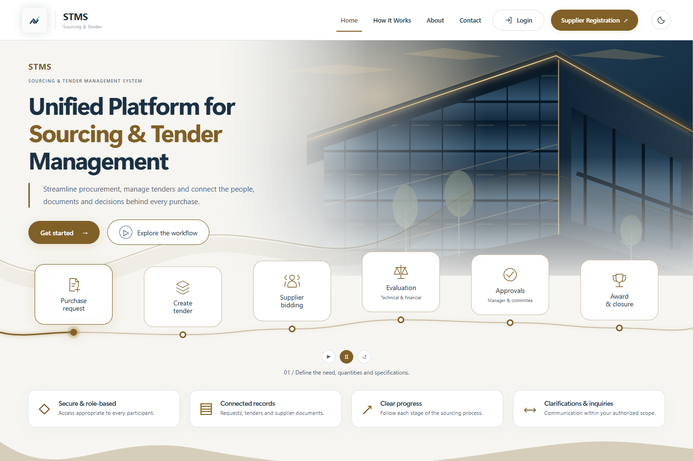
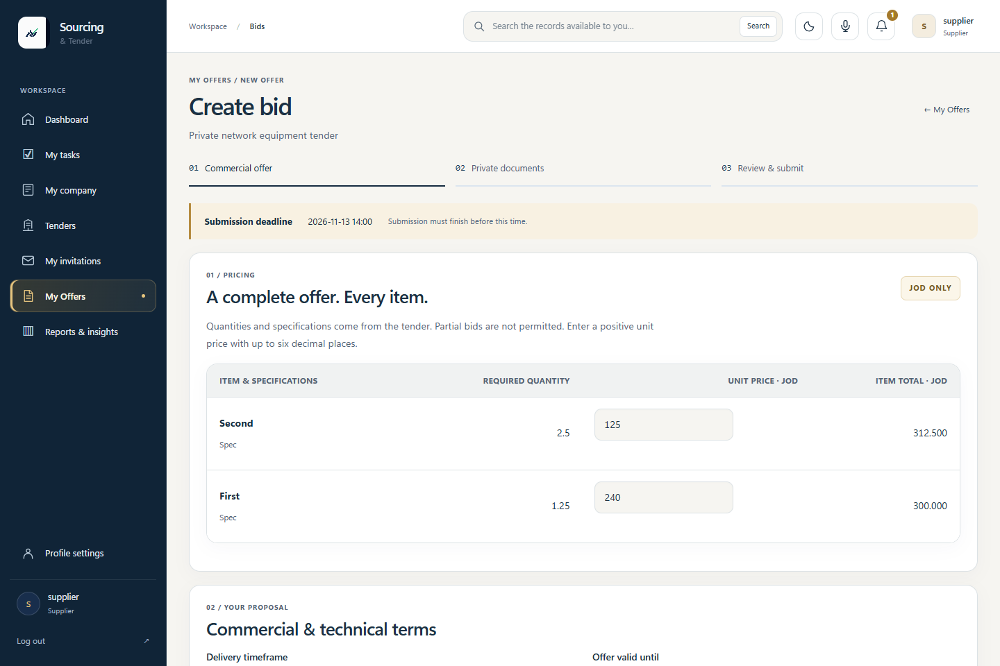
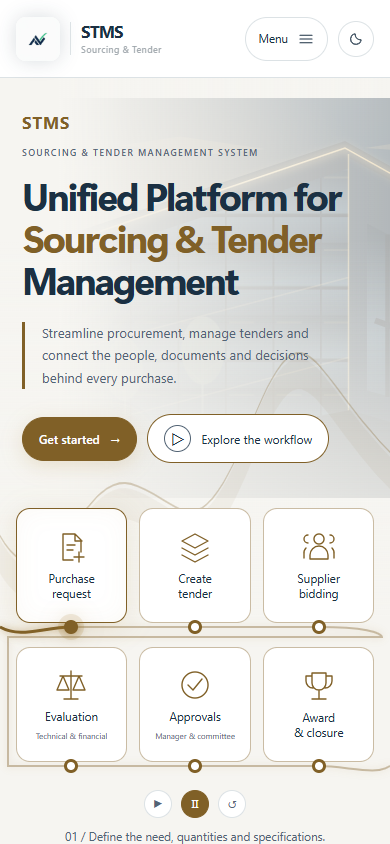
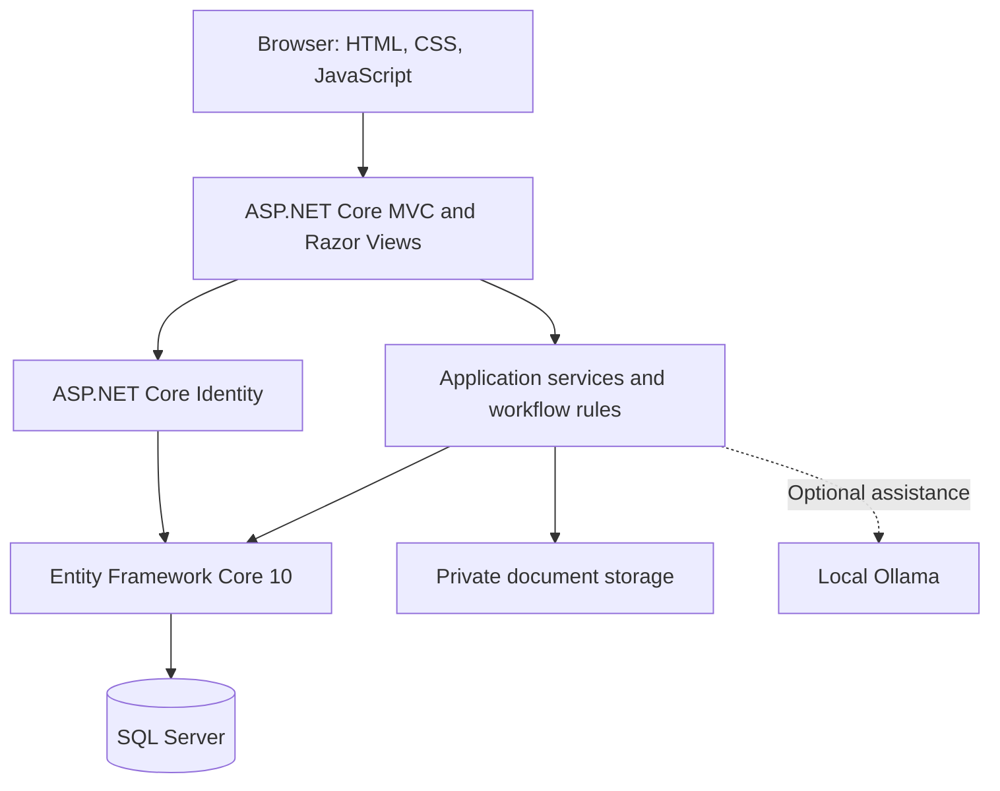

<p align="center">
  
</p>

<h1 align="center">Sourcing &amp; Tender Management System</h1>

<p align="center">
  A role-aware procurement workspace connecting purchase requests, supplier participation,<br />
  tender evaluation, committee decisions, and award records.
</p>

<p align="center">
  <strong>ASP.NET Core MVC · .NET 10 · EF Core 10 · SQL Server · ASP.NET Core Identity</strong>
</p>

<p align="center">
  <a href="#capabilities">Capabilities</a> ·
  <a href="#workflow">Workflow</a> ·
  <a href="#getting-started">Getting started</a> ·
  <a href="#verification">Verification</a> ·
  <a href="#documentation">Documentation</a>
</p>

[](docs/images/screenshots/public-home.png)

<p align="center"><sub>The STMS public landing page, captured directly from the running application.</sub></p>

## Overview

STMS brings procurement records, documents, reviews, and decisions into one server-rendered application. Departments raise purchase requisitions; sourcing teams prepare tenders and invite approved suppliers; assigned committees evaluate submissions and record their decisions.

The application uses MVC controllers, Razor Views, application services, and EF Core persistence. Its interface is built with HTML, CSS, Bootstrap 5, and vanilla JavaScript, with responsive layouts, light/dark appearance, and reduced-motion support. There is no React, Vue, Next.js, or Web API frontend.

**Project status:** the implemented procurement journey has passed isolated SQL, service/MVC, and browser verification. Production rollout still requires environment configuration, approved database migrations, and acceptance on the intended devices and infrastructure. See [deployment readiness](#deployment-readiness).

## Product tour

These are unaltered screenshots of the **actual Razor interfaces**, captured in Microsoft Edge in an isolated verification environment. Visible accounts, metrics, dates, and procurement records are test data. The Tender Details template is rendered with sample data. Click any image to open its full resolution. [Capture details](docs/images/screenshots/capture-info.json).

### Administration workspace

An operational overview brings administrative counts, pending supplier applications, requisition status, and tender deadlines into a shared navigation shell.

[](docs/images/screenshots/admin-overview.png)

<details>
<summary><strong>Tender details and lifecycle tracking</strong></summary>

Tender context, source requisition, requested items, permitted actions, and the saved workflow stage remain together in the detail view.

[](docs/images/screenshots/tender-details.png)

</details>

<details>
<summary><strong>Supplier bid preparation</strong></summary>

The supplier-facing form presents authoritative quantities, JOD unit prices, calculated line totals, and the commercial/document/submission preparation sequence. Example unit prices were entered without saving or submitting the form.

[](docs/images/screenshots/supplier-bid.png)

</details>

<details>
<summary><strong>Reports and insights</strong></summary>

A role-scoped report library organizes filters, matching-record metrics, and Excel/PDF export actions.

[](docs/images/screenshots/reports-workspace.png)

</details>

<details>
<summary><strong>Account access</strong></summary>

A shared public identity connects password sign-in, previously registered device passkeys, and supplier registration. Available device verification methods depend on the user's hardware and OS.

[](docs/images/screenshots/account-login.png)

</details>

<details>
<summary><strong>Dark appearance</strong></summary>

The same administrative workspace supports a persistent light/dark preference without changing permissions or workflow actions.

[](docs/images/screenshots/admin-dark.png)

</details>

<details>
<summary><strong>Mobile layout</strong></summary>

The public page adapts its navigation, typography, calls to action, and workflow presentation to a narrow viewport. This capture uses a 390 × 844 viewport; it is a browser viewport check, not a claim of physical-device certification.

<p align="center">
  <a href="docs/images/screenshots/mobile-home.png"></a>
</p>

</details>

## Capabilities

| Area | Implemented capabilities |
| --- | --- |
| Public website | Landing page, dedicated About and Contact pages, contact messages delivered to administrators, and database-backed public statistics. |
| Administration | Employee and department management, multiple employee roles, supplier application review, administrative dashboard, and contact-message inbox. |
| Supplier onboarding | Company registration, duplicate registration/tax-number protection, mandatory official documents, and Pending/Approved/Rejected/Suspended account states. |
| Purchase requisitions | Itemized drafts, owner editing, submission, cross-department sourcing review, approval, rejection, return for correction, and recorded history. |
| Tenders and invitations | Conversion from an approved requisition, draft editing, criteria configuration and manager approval, publication/opening/closure, and supplier accept/decline responses. |
| Supplier bids | One bid per tender participation, editable drafts, authoritative quantities, JOD pricing, explicit final submission, private attachments, and personal offer summaries. |
| Evaluation and decisions | Compliance review, tender-specific committee assignments, confirmed technical/financial evaluations, unified reports, manager review, voting rounds, and award recording. |
| Collaboration and reporting | Scoped clarifications, in-app notifications and read state, role-restricted reports, Excel/PDF exports, audit records, and QR links. |
| Account experience | Role-specific dashboards, profile settings, protected account actions, voice-search interface, and passkey support. |
| Optional integrations | Local Ollama bid-analysis assistance, document text/OCR extraction, and opt-in camera-based face verification within account settings. |

Optional integrations depend on their local services, models, configuration, and hardware. Camera verification does not replace native passkey authentication, and AI output does not replace authorized human decisions.

## Workflow


Each stage has its own role, ownership, assignment, status, and deadline checks. A supplier must be approved and accept an invitation before creating a bid. Submitted bids and attachments are immutable to the supplier. Internal bid visibility is restricted by tender stage and committee assignment; the Admin role does not automatically grant confidential bid access.

## Roles and responsibilities

| Role | Primary responsibility |
| --- | --- |
| Admin | Accounts, departments, supplier applications, messages, and authorized administrative oversight. |
| Requesting Department | Create, correct, submit, and track the user's own purchase requisitions. |
| Sourcing Officer | Review eligible requisitions across departments, manage tenders/invitations, and perform authorized procurement actions. |
| Supplier | Maintain the company's participation, invitations, own offers, and private bid documents. |
| Evaluation Committee | Evaluate only assigned tenders at the permitted stage and confirm individual results. |
| Sourcing Manager | Approve criteria configured by another user, manage committee assignments, and review evaluation reports. |
| Top Committee | Participate in assigned final-decision rounds under the approved voting rules. |

Role membership alone is insufficient where ownership, department exclusions, tender assignment, account eligibility, or process stage also applies. Module documentation records those restrictions.

## Security and document handling

- ASP.NET Core Identity handles user accounts, password hashing, authentication cookies, and role membership.
- Server-side authorization enforces account eligibility, ownership, department restrictions, tender assignments, and workflow transitions.
- Modifying MVC actions use antiforgery protection; public submission endpoints have rate limiting.
- Supplier-registration and bid documents are stored privately outside `wwwroot`, with generated storage identifiers and protected download actions.
- PDF, JPG, and PNG uploads are checked for size, extension, signature, and decoding validity. Bid attachments are limited to 5 MB each and 10 per bid.
- Protected document copies are personalized and flattened through a bounded worker. Originals remain private and unchanged.
- Concurrency checks, transactions, database constraints, notifications, and audit records support workflow integrity.

These controls describe the implementation; they are not an independent security certification.

## Technology

| Layer | Stack |
| --- | --- |
| Application | ASP.NET Core MVC and Razor Views, .NET 10 |
| Persistence | Entity Framework Core 10 and SQL Server |
| Authentication | ASP.NET Core Identity and WebAuthn/passkeys |
| Interface | HTML5, CSS3, Bootstrap 5, vanilla JavaScript |
| Documents | PDFsharp, PdfPig, PDFtoImage, TesseractOCR, and QRCoder |
| Optional AI | Locally hosted Ollama with the configured model |
| Verification | Executable .NET check projects and Playwright scripts using Edge |

## Architecture

STMS keeps the browser experience within the existing MVC application. Razor Views render HTML, application services enforce workflow rules, and EF Core persists relational data. Private document storage is separate from public assets.



## Getting started

### Prerequisites

- .NET 10 SDK.
- An authorized SQL Server instance and database.
- A trusted development HTTPS certificate.
- For browser checks: an existing Node.js, Playwright, and Microsoft Edge installation. These are test tooling, not application frontend dependencies.

### Local configuration

```powershell
git clone https://github.com/M-Khasawneh/STMS.git
cd STMS

Copy-Item src/SourcingTenderManagementSystem.Web/appsettings.Example.json `
          src/SourcingTenderManagementSystem.Web/appsettings.json
```

Edit the local configuration with your SQL Server connection. Keep it out of Git. Set `PublicSite:Origin` and `Passkeys:Origin` to the application's actual HTTPS origin; configure `AllowedHosts` for the intended host. Environment variables such as `ConnectionStrings__DefaultConnection` can supply deployment configuration instead of a local file.

The example contains placeholders, not credentials. No default administrator password or pre-populated user database is distributed.

### Build and run

```powershell
dotnet restore SourcingTenderManagementSystem.slnx
dotnet build SourcingTenderManagementSystem.slnx --no-restore
dotnet run --project src/SourcingTenderManagementSystem.Web --launch-profile https
```

The checked-in HTTPS launch profile uses `https://localhost:7162`. Trust/configure your development certificate before signing in; authentication cookies require HTTPS.

**Database setup is explicit.** Normal startup does not apply migrations or seed users. Review the migration history and historical first-Admin prerequisite before initializing a new database. Use the [database design](docs/database-design.md), [employee/department migration](docs/employee-management.md), and [first-Admin provisioning](docs/first-admin-provisioning.md) notes. Never apply migrations or provisioning commands to an existing database without reviewing the target and obtaining authorization.

Private uploads, OCR language data, local configuration, and databases are intentionally not included in this repository. Optional OCR/model setup is covered in the [document extraction notes](docs/bid-document-extraction.md).

## Repository structure

```text
src/SourcingTenderManagementSystem.Web/
├── Controllers/       MVC actions and request handling
├── Data/              Application services, EF Core context, migrations, and file storage
├── Models/            Entities, view models, and workflow contracts
├── Security/          Identity, eligibility, passkeys, and account safeguards
├── Views/             Razor pages, shared layouts, and partials
└── wwwroot/           Public styles, scripts, images, and vendor assets

tests/
├── SourcingTenderManagementSystem.AuthenticationChecks/
├── SourcingTenderManagementSystem.SchemaChecks/
└── *.cjs              Isolated browser checks and test runners

docs/                  Module documentation, decisions, and verification notes
scripts/               Explicit local setup utilities
```

## Verification

The latest readiness verification completed 27 safe service/MVC groups, 28 browser groups after two targeted test corrections, offline checks for 10 migrations, and a connected SQL workflow with 58 checkpoints. The SQL run used a separately created synthetic database, removed it afterward, and verified that the existing database's content fingerprints were unchanged. This is not a claim that one SQL-backed browser session exercised every form or every deployment scenario.

## Deployment readiness

Before deploying to a real environment:

- Supply production secrets and connection settings through the deployment environment. Local `appsettings*.json` files and `App_Data` are excluded from publish output; `appsettings.Example.json` remains a template.
- Review and explicitly apply required migrations. In the last inspected local database, `20261116152333_BidParticipationUniqueness` and the camera-settings migration were still pending; they were tested/applied only in an isolated test database.
- Configure HTTPS, public/passkey origins, allowed hosts, and trusted proxy settings where applicable.
- Grant the application identity the required private-storage permissions and arrange durable backups for the database, documents, and Data Protection keys.
- Verify the published native document workers on the target OS and under the actual service identity.
- Perform real camera, microphone, and native authenticator acceptance. Simulated tests do not demonstrate physical face/fingerprint/PIN or speech recognition.
- Verify Ollama and the required local model if enabling AI assistance. Actual model generation was not verified in the latest readiness run because the service was unavailable.

The published application was smoke-tested locally in Production mode. A deployed TLS/proxy environment, backup restoration, and Linux/macOS operation have not been certified.

## Documentation

- [Purchase requisitions](docs/purchase-requisitions.md)
- [Tenders and supplier invitations](docs/tenders-invitations.md)
- [Supplier registration](docs/supplier-registration.md)
- [Supplier bids and private documents](docs/bids-phase3.md)
- [Evaluation and scoring](docs/evaluation-scoring.md)
- [Unified evaluation report](docs/unified-evaluation-report.md)
- [Top Committee decisions and awards](docs/top-committee.md)
- [Reporting](docs/reporting.md)
- [Passkeys](docs/identity-passkeys.md) and [physical-device acceptance](docs/physical-device-acceptance.md)
- [Protected PDF verification](docs/pdf-browser-regression-fixes.md)

The original V5 requirements are maintained separately by the project owner and are not distributed in this public repository. Some earlier analysis notes record superseded questions; module-specific approved decisions and the current implementation provide the updated behavior.

## License

A project-wide license has not been declared. Public repository visibility does not grant an open-source license. Third-party libraries and assets retain their respective licenses; see their bundled notices and [third-party documentation](docs/third-party/).
