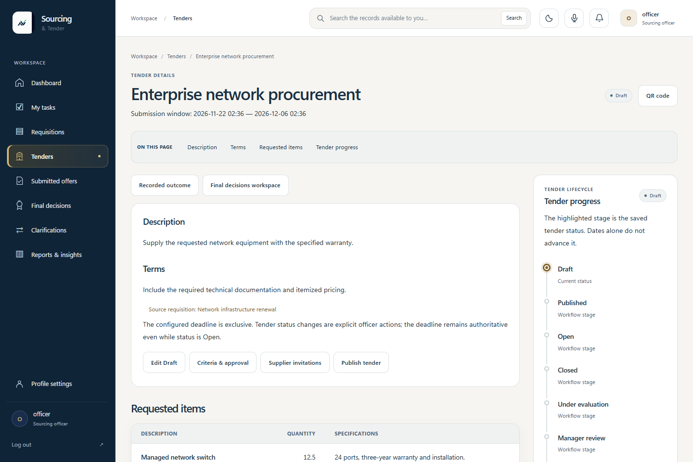
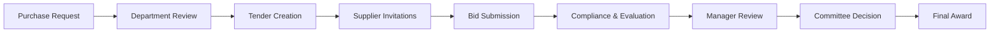

<div align="center">Sourcing & Tender Management System
A role-based procurement platform that brings purchasing requests, tender management, supplier bidding, evaluation, and award decisions into one workflow.

Built with ASP.NET Core MVC · .NET 10 · Entity Framework Core · SQL Server
<p>
  <a href="https://stms-khasawneh.runasp.net/"><strong>Explore Live Website</strong></a>
  &nbsp;·&nbsp;
  <a href="https://github.com/M-Khasawneh/STMS"><strong>Source Code</strong></a>
  &nbsp;·&nbsp;
  <a href="#getting-started"><strong>Getting Started</strong></a>
</p>
<a href="https://stms-khasawneh.runasp.net/"></a>


</div><div align="center">
  <a href="https://stms-khasawneh.runasp.net/">
    
  </a>
  <sub>Public homepage · Click the screenshot to open the live website.</sub>
</div>Overview
STMS is a web-based procurement and tender management system designed to coordinate the purchasing lifecycle across departments, sourcing teams, suppliers, and evaluation committees.

Instead of managing requests, offers, and approvals across disconnected processes, STMS connects each stage—from a department's initial purchase request to the final award—while enforcing role-based access and workflow-specific business rules.

The project uses server-rendered Razor Views, application services, ASP.NET Core Identity, and EF Core with SQL Server. It is structured as an ASP.NET Core MVC application rather than a separate frontend/API architecture.
Key capabilities
Area	What the system supports
Procurement requests	Draft, itemize, submit, review, approve, reject, or return requests for correction.
Tender management	Create tenders from approved requests, define criteria and deadlines, and invite eligible suppliers.
Supplier onboarding	Register companies, upload required documents, and review applications with recorded decisions.
Supplier bids	Prepare itemized JOD quotations, upload private documents, save drafts, and submit before deadlines.
Evaluation & compliance	Apply tender-specific access rules, evaluate technical and financial offers, and prepare consolidated reports.
Committee decisions	Manage assigned voting rounds and record final award decisions.
Operations & reporting	Role-specific dashboards, notifications, clarifications, search, and Excel/PDF exports.


Interface & accessibility
- Responsive layouts for desktop and mobile screens.
- Light and dark appearance modes.
- Reduced-motion preference support.
- Role-specific navigation and contextual actions.
Application preview
Screenshots show sample records and accounts captured from isolated testing or preview environments; they do not contain live production data.

<table>
  <tr>
    <td width="50%" align="center">
      <a href="docs/images/screenshots/admin-overview.png"></a>
      <br /><strong>Administration dashboard</strong>
    </td>
    <td width="50%" align="center">
      <a href="docs/images/screenshots/tender-details.png"></a>
      <br /><strong>Tender management</strong>
    </td>
  </tr>
  <tr>
    <td width="50%" align="center">
      <a href="docs/images/screenshots/supplier-bid.png"></a>
      <br /><strong>Supplier bid submission</strong>
    </td>
    <td width="50%" align="center">
      <a href="docs/images/screenshots/reports-workspace.png"></a>
      <br /><strong>Reports & analytics</strong>
    </td>
  </tr>
</table><details>
<summary><strong>More screenshots — authentication, dark mode & mobile</strong></summary>
Sign-in	Dark mode	Mobile homepage
<a href="docs/images/screenshots/account-login.png"></a>	<a href="docs/images/screenshots/admin-dark.png"></a>	<a href="docs/images/screenshots/mobile-home.png"></a>


[View screenshot capture notes](docs/images/screenshots/capture-info.json)
</details>
## Procurement Workflow

The system manages the procurement lifecycle from the initial purchase request to the final award.



A supplier must be approved and accept an invitation before preparing an offer. Submission deadlines, ownership, tender stage, and committee assignments are enforced on the server.

> **Security:** Administrative access does not automatically grant visibility into confidential supplier offers.

---

## Roles & Access Control

The application implements seven distinct roles, each with clearly defined responsibilities and access boundaries.

| Role | Primary Responsibility |
|------|------------------------|
| **Admin** | Manage employees, departments, supplier applications, and system administration. |
| **Requesting Department** | Create and track authorized purchase requests. |
| **Sourcing Officer** | Manage eligible requests, tenders, and supplier invitations. |
| **Supplier** | Manage the company's own invitations and bids. |
| **Evaluation Committee** | Review and score offers for assigned tenders. |
| **Sourcing Manager** | Review evaluation criteria, assign committees, and assess evaluation reports. |
| **Top Committee** | Participate in assigned final-decision voting rounds. |

**Authorization Model**

Authorization combines ASP.NET Core Identity with:

- Role-based access control (RBAC)
- Resource ownership validation
- Department-level access restrictions
- Tender and committee assignment checks
- Workflow-state validation

---

## Technology Stack

| Layer | Technologies |
|-------|--------------|
| **Backend** | C#, .NET 10, ASP.NET Core MVC, Razor Views |
| **Database** | Microsoft SQL Server, Entity Framework Core 10 |
| **Authentication & Security** | ASP.NET Core Identity, role- and resource-based authorization, passkeys |
| **Frontend** | HTML5, CSS3, Bootstrap 5, Vanilla JavaScript |
| **Document Processing** | PDFsharp, PdfPig, PDFtoImage, TesseractOCR |
| **Utilities** | QRCoder |
| **AI Integration (Optional)** | Ollama-assisted bid analysis with human-controlled decisions |


## Project Structure

```text
STMS/
├── src/
│   └── SourcingTenderManagementSystem.Web/
│       ├── Controllers/   # MVC controllers and HTTP actions
│       ├── Data/          # Services, EF Core, migrations, storage
│       ├── Models/        # Domain entities and view models
│       ├── Security/      # Identity, authorization, passkeys
│       ├── Views/         # Razor views and shared layouts
│       └── wwwroot/       # CSS, JavaScript, images and assets
├── tests/                 # Automated and browser tests
├── docs/                  # Technical documentation
└── scripts/               # Development utilities
```

> Private uploaded documents are stored outside `wwwroot`
> and accessed through authorized application endpoints.

## Getting Started


### Prerequisites

Before running the application locally, make sure you have:

- .NET 10 SDK
- Microsoft SQL Server
- A trusted HTTPS development certificate
- Git

### 1. Clone the Repository

```bash
git clone https://github.com/M-Khasawneh/STMS.git
cd STMS
```

### 2. Configure the Application

Create a local configuration file using the provided example:

```powershell
Copy-Item src/SourcingTenderManagementSystem.Web/appsettings.Example.json `
          src/SourcingTenderManagementSystem.Web/appsettings.json
```

Update your local configuration with:

- SQL Server connection settings.
- `PublicSite:Origin` matching your local HTTPS address.
- `Passkeys:Origin` matching the same trusted origin.

The default HTTPS development URL is:

`https://localhost:7162`

### 3. Restore Dependencies

```bash
dotnet restore SourcingTenderManagementSystem.slnx
```

### 4. Build the Solution

```bash
dotnet build SourcingTenderManagementSystem.slnx --no-restore
```

### 5. Run the Application

```bash
dotnet run --project src/SourcingTenderManagementSystem.Web --launch-profile https
```

> **Database setup:** The repository does not include a populated database, default credentials, or automatic database initialization. Review the database and administrator provisioning documentation before applying migrations.

For detailed instructions, see:

- [Database Design](docs/database-design.md)
- [First Admin Provisioning](docs/first-admin-provisioning.md)
- [Employee Management](docs/employee-management.md)

> **Security Notice:** Never commit production credentials, connection strings containing secrets, private uploads, database backups, or Data Protection keys.

---

## Testing & Deployment

The project has undergone service-level, MVC, browser, and isolated SQL workflow testing.

These tests validate important application behaviors but do not guarantee compatibility with every production environment.

### Production Readiness Checklist

Before deploying the application, verify:

- [ ] Review and apply required database migrations.
- [ ] Configure HTTPS, allowed hosts, and trusted origins.
- [ ] Secure production credentials and application secrets.
- [ ] Configure reverse proxy settings where applicable.
- [ ] Verify private document storage permissions.
- [ ] Configure persistent ASP.NET Core Data Protection keys.
- [ ] Establish database and file backup procedures.
- [ ] Validate protected PDF processing on the hosting server.
- [ ] Test camera, microphone, and native passkeys on supported devices.
- [ ] Verify Ollama integration if AI-assisted analysis is enabled.

**Additional verification:**

- [Physical Device Acceptance](docs/physical-device-acceptance.md)
- [Protected PDF Verification](docs/pdf-browser-regression-fixes.md)

> Linux/macOS deployment and backup restoration were not verified in the latest readiness assessment.

---

## Documentation

Detailed technical and functional documentation is available in the `docs/` directory.

| Category | Documentation |
|----------|---------------|
| **Procurement** | [Purchase Requests](docs/purchase-requisitions.md) · [Tenders & Invitations](docs/tenders-invitations.md) |
| **Supplier Management** | [Supplier Registration](docs/supplier-registration.md) · [Bids & Documents](docs/bids-phase3.md) |
| **Evaluation** | [Evaluation & Scoring](docs/evaluation-scoring.md) · [Unified Evaluation Report](docs/unified-evaluation-report.md) |
| **Decisions** | [Committee Decisions & Awards](docs/top-committee.md) |
| **Reporting** | [Reporting & Exports](docs/reporting.md) |
| **Security** | [Identity & Passkeys](docs/identity-passkeys.md) · [Employee Management](docs/employee-management.md) |
| **Document Processing** | [Document Extraction](docs/bid-document-extraction.md) · [PDF Verification](docs/pdf-browser-regression-fixes.md) |

---

## License

No project-wide license has been selected.

Public availability of this repository does not automatically grant permission to reuse, modify, or redistribute its source code.

Third-party libraries and components retain their respective licenses.

See the [Third-Party Notices](docs/third-party/) for additional information.

<div align="center">
  <strong>Explore STMS</strong>
  <p><a href="https://stms-khasawneh.runasp.net/">Live Website</a> · <a href="https://github.com/M-Khasawneh/STMS">GitHub Repository</a></p>
</div>
