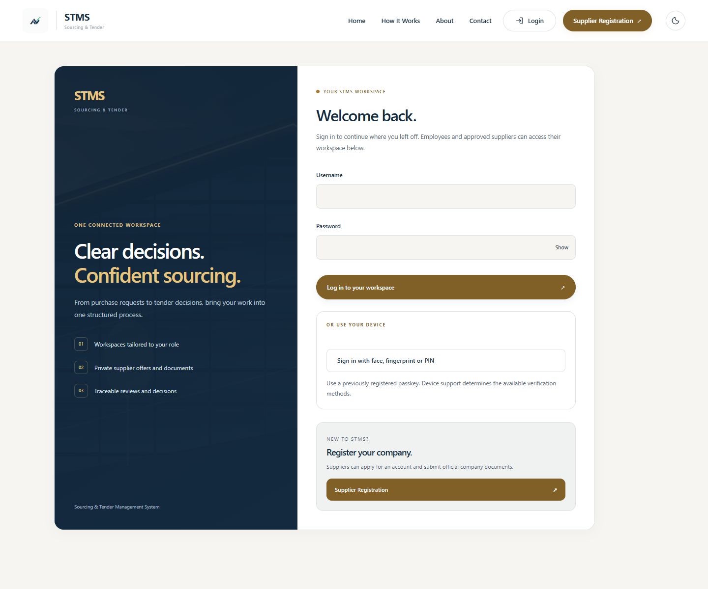

<p align="center">
  
</p>

<h1 align="center">Sourcing &amp; Tender Management System</h1>

<p align="center">Purchase requests, tenders, supplier offers, and committee decisions in one application.</p>

<p align="center">
  ASP.NET Core MVC · .NET 10 · EF Core 10 · SQL Server · ASP.NET Core Identity
</p>

<p align="center">
  <a href="#features">Features</a> ·
  <a href="#screenshots">Screenshots</a> ·
  <a href="#workflow">Workflow</a> ·
  <a href="#running-locally">Running locally</a> ·
  <a href="#documentation">Documentation</a>
</p>

[](docs/images/screenshots/public-home.png)

## About the project

STMS follows a purchase from the initial request through tendering, supplier bids, evaluation, and award. Departments submit their requests, sourcing officers prepare tenders and invite suppliers, and assigned committees review the offers and record their decisions.

The application is built with ASP.NET Core MVC and Razor Views. The frontend uses HTML, CSS, Bootstrap 5, and vanilla JavaScript. Each user sees the pages and records available to their role, with additional checks for ownership, department, tender assignment, and workflow stage.

## Features

- **Administration:** manage employees, departments, roles, supplier applications, and contact messages.
- **Supplier registration:** collect company information and official documents, then approve, reject, or suspend applications with recorded reasons.
- **Purchase requests:** save drafts, add items, submit for review, and handle approval, rejection, or correction.
- **Tenders:** create a tender from an approved request, configure evaluation criteria, manage dates, and invite approved suppliers.
- **Supplier offers:** prepare JOD pricing, attach private documents, and submit an offer before the deadline. Submitted offers cannot be edited by the supplier.
- **Evaluation:** assign committees to a tender, record technical and financial scores, prepare a unified report, and send it for review.
- **Decisions:** run committee voting rounds and record the winning offer and award.
- **Daily work:** role-specific dashboards, notifications, clarifications, search, reports, and Excel/PDF exports.

The public website includes the homepage, About, Contact, sign-in, and supplier registration pages. The interface supports light and dark modes, mobile layouts, and reduced-motion preferences.

## Screenshots

These screenshots were taken from the application's Razor Views in an isolated test environment. The records, accounts, and figures shown are sample data. The tender detail view uses the existing render-only test host. Click an image to see it at full size.

### Admin dashboard

System counts, pending applications, and upcoming tender deadlines.

[](docs/images/screenshots/admin-overview.png)

<details>
<summary><strong>Tender details</strong></summary>

The source request, terms, items, available actions, and tender status are shown together.

[](docs/images/screenshots/tender-details.png)

</details>

<details>
<summary><strong>Supplier bid form</strong></summary>

Suppliers enter unit prices against the requested quantities. The form calculates line totals in JOD.

[](docs/images/screenshots/supplier-bid.png)

</details>

<details>
<summary><strong>Reports</strong></summary>

Report categories, filters, summary figures, and export options.

[](docs/images/screenshots/reports-workspace.png)

</details>

<details>
<summary><strong>Sign-in page</strong></summary>

Password sign-in, registered device passkeys, and the link to supplier registration.

[](docs/images/screenshots/account-login.png)

</details>

<details>
<summary><strong>Dark mode</strong></summary>

[](docs/images/screenshots/admin-dark.png)

</details>

<details>
<summary><strong>Mobile view</strong></summary>

The homepage at a 390 × 844 browser viewport.

<p align="center">
  <a href="docs/images/screenshots/mobile-home.png"></a>
</p>

</details>

[Capture notes](docs/images/screenshots/capture-info.json)

## Workflow


Suppliers must be approved and accept their invitation before creating a bid. Tender deadlines are checked on the server. Bid access also depends on the tender stage and committee assignment; being an Admin does not grant access to confidential proposal contents.

## User roles

| Role | Main responsibility |
| --- | --- |
| Admin | Users, departments, supplier applications, and administrative oversight |
| Requesting Department | Create and follow up on the user's own purchase requests |
| Sourcing Officer | Review eligible requests and manage tenders, invitations, and authorized procurement actions |
| Supplier | Respond to invitations and manage the company's own offers |
| Evaluation Committee | Evaluate offers for assigned tenders |
| Sourcing Manager | Approve criteria, assign committees, and review evaluation reports |
| Top Committee | Vote in assigned final-decision rounds |

The detailed restrictions are covered in the module documentation below.

## Project structure

```text
src/SourcingTenderManagementSystem.Web/
├── Controllers/       MVC actions
├── Data/              Application services, database context, migrations, and file storage
├── Models/            Entities and view models
├── Security/          Identity, account eligibility, and passkeys
├── Views/             Razor Views and shared layouts
└── wwwroot/           Public CSS, JavaScript, images, and vendor files

tests/                 Service, MVC, schema, and browser checks
docs/                  Module documentation and verification notes
scripts/               Local setup utilities
```

Controllers use application services for workflow rules and EF Core for SQL Server persistence. Uploaded documents are stored outside `wwwroot` and accessed through protected actions.

PDFsharp, PdfPig, PDFtoImage, TesseractOCR, and QRCoder handle document-related work. Optional Ollama integration provides bid-analysis assistance; human reviewers still make the decisions.

## Running locally

You need the .NET 10 SDK, access to a SQL Server database, and a trusted HTTPS development certificate.

```powershell
git clone https://github.com/M-Khasawneh/STMS.git
cd STMS

Copy-Item src/SourcingTenderManagementSystem.Web/appsettings.Example.json `
          src/SourcingTenderManagementSystem.Web/appsettings.json
```

Set your SQL Server connection in the local configuration. `PublicSite:Origin` and `Passkeys:Origin` must match the HTTPS address you use. The included HTTPS launch profile uses `https://localhost:7162`.

```powershell
dotnet restore SourcingTenderManagementSystem.slnx
dotnet build SourcingTenderManagementSystem.slnx --no-restore
dotnet run --project src/SourcingTenderManagementSystem.Web --launch-profile https
```

No default password or populated database is included. Startup does not apply migrations or create users. Before setting up a database, read the [database notes](docs/database-design.md), [employee and department setup](docs/employee-management.md), and [first Admin provisioning guide](docs/first-admin-provisioning.md). The migration history includes a first-Admin prerequisite, so review it before applying migrations to a new database.

Keep real configuration, connection credentials, uploads, and database backups out of Git. Private documents and local OCR/model data need to be provided separately. See [document extraction](docs/bid-document-extraction.md) for the optional setup.

## Before deployment

The procurement workflow has been exercised with an isolated SQL database, alongside service/MVC and browser tests. The remaining deployment work depends on the target environment:

- Review pending migrations. The last inspected local database still needed the bid-uniqueness and camera-settings migrations.
- Supply production configuration through the deployment environment. Local `appsettings*.json` files and `App_Data` are excluded from publish output; the example file is only a template.
- Configure HTTPS, allowed hosts, public/passkey origins, and proxy settings where needed.
- Set private-storage permissions and back up the database, uploaded files, and Data Protection keys.
- On a single Windows host without a user-profile key store, `DataProtection__PersistWindowsKeys=true` stores DPAPI-encrypted keys in `App_Data/DataProtection-Keys`. Preserve this folder across deployments. These keys are tied to that Windows server; plan key migration before moving hosts.
- Check the document workers under the account and OS that will run the application.

Camera verification, voice recognition, and native passkeys need testing on the actual devices. The browser tests use simulated devices. Ollama also needs a running local service and model; real generation was not verified in the last readiness run because the service was unavailable. Camera-based verification is optional and does not replace passkeys. Linux/macOS deployment and backup restoration have not been verified.

## Documentation

- [Purchase requests](docs/purchase-requisitions.md)
- [Tenders and invitations](docs/tenders-invitations.md)
- [Supplier registration](docs/supplier-registration.md)
- [Supplier bids and documents](docs/bids-phase3.md)
- [Evaluation and scoring](docs/evaluation-scoring.md)
- [Unified evaluation report](docs/unified-evaluation-report.md)
- [Committee decisions and awards](docs/top-committee.md)
- [Reports](docs/reporting.md)
- [Passkeys](docs/identity-passkeys.md)
- [Physical-device checks](docs/physical-device-acceptance.md)
- [Protected PDF checks](docs/pdf-browser-regression-fixes.md)

The V5 requirements document is maintained separately from the current source tree. Some early analysis notes contain questions that were resolved later; refer to the relevant module's approved decisions for the current rules.

## License

No project-wide license has been selected. Public visibility alone does not grant permission to reuse the code. Third-party components keep their own licenses; their notices are included with the files and in [docs/third-party](docs/third-party/).
