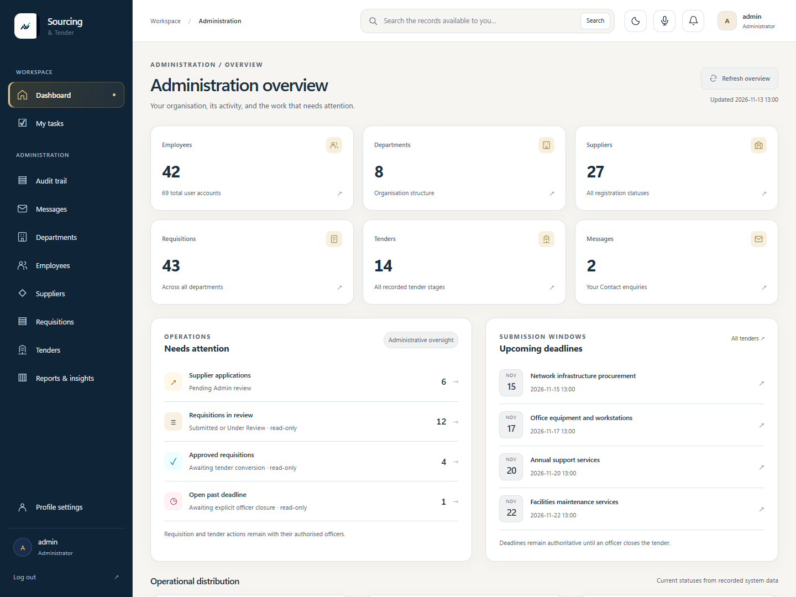
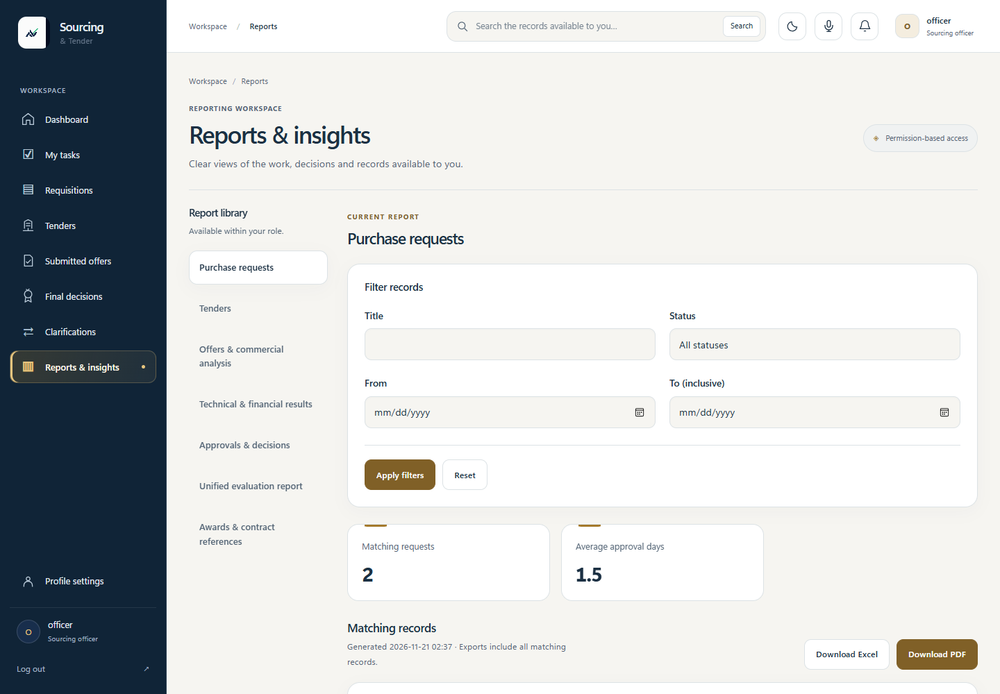
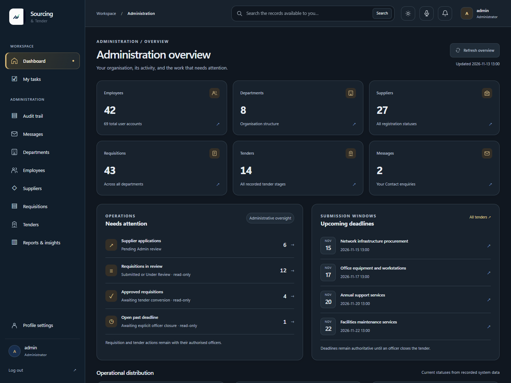

Sourcing & Tender Management System
A role-based procurement platform that brings purchasing requests, tender management, supplier bidding, evaluation, and award decisions into one workflow.

Built with ASP.NET Core MVC · .NET 10 · Entity Framework Core · SQL Server

  <a href="https://stms-khasawneh.runasp.net/"><strong>Explore Live Website</strong></a>
  &nbsp;·&nbsp;
  <a href="https://github.com/M-Khasawneh/STMS"><strong>Source Code</strong></a>
  &nbsp;·&nbsp;
  <a href="#getting-started"><strong>Getting Started</strong></a>

  
  Public homepage · Click the screenshot to open the live website.

Overview
STMS is a web-based procurement and tender management system designed to coordinate the purchasing lifecycle across departments, sourcing teams, suppliers, and evaluation committees.

Instead of managing requests, offers, and approvals across disconnected processes, STMS connects each stage—from a department's initial purchase request to the final award—while enforcing role-based access and workflow-specific business rules.

The project uses server-rendered Razor Views, application services, ASP.NET Core Identity, and EF Core with SQL Server. It is structured as an ASP.NET Core MVC application rather than a separate frontend/API architecture.
Key capabilities
Area	What the system supports
Procurement requests	Draft, itemize, submit, review, approve, reject, or return requests for correction.
Tender management	Create tenders from approved requests, define criteria and deadlines, and invite eligible suppliers.
Supplier onboarding	Register companies, upload required documents, and review applications with recorded decisions.
Supplier bids	Prepare itemized JOD quotations, upload private documents, save drafts, and submit before deadlines.
Evaluation & compliance	Apply tender-specific access rules, evaluate technical and financial offers, and prepare consolidated reports.
Committee decisions	Manage assigned voting rounds and record final award decisions.
Operations & reporting	Role-specific dashboards, notifications, clarifications, search, and Excel/PDF exports.

Interface & accessibility
- Responsive layouts for desktop and mobile screens.
- Light and dark appearance modes.
- Reduced-motion preference support.
- Role-specific navigation and contextual actions.
Application preview
Screenshots show sample records and accounts captured from isolated testing or preview environments; they do not contain live production data.

<table>
  <tr>
    <td width="50%" align="center">
      
       <strong>Administration dashboard</strong>
    </td>
    <td width="50%" align="center">
      
       <strong>Tender management</strong>
    </td>
  </tr>
  <tr>
    <td width="50%" align="center">
      
       <strong>Supplier bid submission</strong>
    </td>
    <td width="50%" align="center">
      
       <strong>Reports & analytics</strong>
    </td>
  </tr>
</table>

<strong>More screenshots — authentication, dark mode & mobile</strong>

Sign-in	Dark mode	Mobile homepage
		

[View screenshot capture notes](docs/images/screenshots/capture-info.json)

Procurement workflow

A supplier must be approved and accept an invitation before preparing an offer. Submission deadlines, ownership, tender stage, and committee assignments are enforced on the server. Administrative access does not automatically grant visibility into confidential offers.
Roles & access control
The application supports seven distinct roles, each with dedicated responsibilities and access boundaries.
Role	Primary responsibility
Admin	Employee and department management, supplier applications, and administration.
Requesting Department	Create and track authorized purchase requests.
Sourcing Officer	Manage eligible requests, tenders, and supplier invitations.
Supplier	Manage the company's own invitations and bids.
Evaluation Committee	Review and score assigned tender offers.
Sourcing Manager	Review criteria, assign committees, and assess evaluation reports.
Top Committee	Participate in assigned final-decision voting rounds.

Authorization combines ASP.NET Core Identity with resource ownership, department scope, assignment checks, and workflow-state validation.
Technology stack
Layer	Technologies
Backend	C#, .NET 10, ASP.NET Core MVC, Razor Views
Data	SQL Server, Entity Framework Core 10
Authentication & authorization	ASP.NET Core Identity, role- and resource-based access checks, passkeys
Frontend	HTML, CSS, Bootstrap 5, vanilla JavaScript
Documents & utilities	PDFsharp, PdfPig, PDFtoImage, TesseractOCR, QRCoder
Optional integration	Ollama-assisted bid analysis (human decisions remain authoritative)

Project layout
STMS/
├── src/
│   └── SourcingTenderManagementSystem.Web/
│       ├── Controllers/   # HTTP endpoints and MVC actions
│       ├── Data/          # Services, EF Core, migrations and storage
│       ├── Models/        # Domain and view models
│       ├── Security/      # Identity, eligibility and passkeys
│       ├── Views/         # Razor pages and shared layouts
│       └── wwwroot/       # Public frontend assets
├── tests/                 # Service, MVC, schema and browser checks
├── docs/                  # Architecture and feature documentation
└── scripts/               # Local development utilities
Private uploaded documents are stored outside wwwroot and served through protected application actions.
Getting started
Prerequisites
- .NET 10 SDK
- SQL Server instance and appropriate database access
- Trusted local HTTPS development certificate
1. Clone the repository
git clone https://github.com/M-Khasawneh/STMS.git
cd STMS
2. Configure your environment
Copy-Item src/SourcingTenderManagementSystem.Web/appsettings.Example.json `
          src/SourcingTenderManagementSystem.Web/appsettings.json
Configure your SQL Server connection and set PublicSite:Origin and Passkeys:Origin to the HTTPS address used locally. The included HTTPS launch profile uses https://localhost:7162.
3. Restore, build & run
dotnet restore SourcingTenderManagementSystem.slnx
dotnet build SourcingTenderManagementSystem.slnx --no-restore
dotnet run --project src/SourcingTenderManagementSystem.Web --launch-profile https
Database initialization is a separate, deliberate step. The repository does not include a populated database or default credentials, and startup does not automatically apply migrations or provision users. Before initializing a fresh database, follow the [database design](docs/database-design.md) and [first Admin provisioning](docs/first-admin-provisioning.md) instructions, including the migration prerequisites.
Security: Never commit real connection strings, credentials, private uploads, database backups, or Data Protection keys. Some document-processing and AI features require separate local services or assets.

Testing & deployment notes
The project has been checked using service/MVC tests, browser checks, and a procurement workflow backed by an isolated SQL test database. These checks do not constitute a blanket guarantee for every deployment environment.

Before production use, verify:
- Pending database migrations, including bid uniqueness and camera settings where applicable.
- HTTPS, allowed hosts, trusted origins, reverse proxy configuration, and production secrets.
- Private file permissions, database/file backups, and persistent Data Protection keys.
- PDF/document processing on the actual hosting environment.
- Native passkeys, microphone and camera capabilities on real devices if those features are needed.
- Ollama inference against a running service if AI-assisted analysis is enabled.
See the [physical-device acceptance checklist](docs/physical-device-acceptance.md) and [protected PDF verification notes](docs/pdf-browser-regression-fixes.md) for more detail. The last reported readiness check did not verify Linux/macOS deployment or backup restoration.
Documentation
Topic	Reference
Procurement & tenders	[Purchase requests](docs/purchase-requisitions.md) · [Tenders and invitations](docs/tenders-invitations.md)
Suppliers & bidding	[Supplier registration](docs/supplier-registration.md) · [Bids and documents](docs/bids-phase3.md)
Evaluation & awards	[Evaluation and scoring](docs/evaluation-scoring.md) · [Unified report](docs/unified-evaluation-report.md) · [Committee decisions](docs/top-committee.md)
Operations & security	[Reporting](docs/reporting.md) · [Passkeys](docs/identity-passkeys.md) · [Employee management](docs/employee-management.md)
Document processing	[Document extraction](docs/bid-document-extraction.md) · [PDF checks](docs/pdf-browser-regression-fixes.md)

License
No project-wide license has been selected. Making the repository public does not, by itself, grant permission to reuse its source code. Third-party components retain their respective licenses; see [third-party notices](docs/third-party/).

  <strong>Explore STMS</strong>
  
<a href="https://stms-khasawneh.runasp.net/">Live Website</a> · <a href="https://github.com/M-Khasawneh/STMS">GitHub Repository</a>

